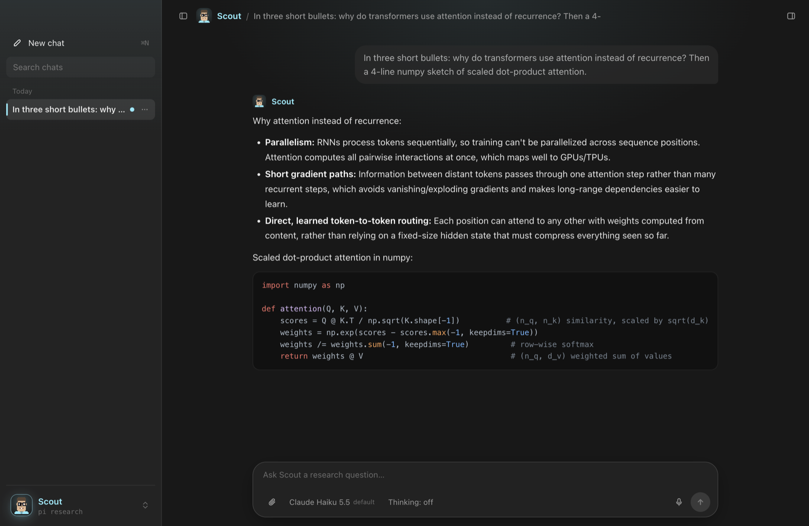

# Pi Desktop

A native-feeling macOS chat app for your [Pi](https://github.com/earendil-works/pi) harnesses.
Every `~/bin/pi-<name>` script becomes a **character** with its own face, accent colour, greeting, chats and finish
sound. Underneath, the app runs your real harness in Pi's RPC mode (same model, extensions, skills, working folder
and `AGENTS.md`), so nothing about how your agents work changes. You just get a better window onto them.



## What you get

- **Characters**: one per harness, switch with ⌘K or ⌘1–9 (ordered by what's in use, then what you use most). Pixel
  faces drawn from a few traits, or your own portraits. Faces blink.
- **Real chats**: streaming replies, thinking and tool calls folded neatly, syntax-highlighted code, paste or drop images and files,
  steer a reply mid-stream (Enter), stop (Esc). Several chats run side by side, even across characters.
- **Chat management**: pin, rename, archive, search (titles and what you wrote), export to HTML, copy as Markdown, delete to Trash.
  Edit a message or regenerate a reply: both branch with Pi's fork, so the original stays intact.
- **Model + thinking pickers** per chat, a context meter, `/` command menu, extension dialogs (`select`, `confirm`, `input`).
- **Tasks**: scheduled prompts per character (daily, weekdays, weekly, every N hours). Each run is a separate headless
  Pi run, saved as a chat, with a notification.
- **Finish sounds**: a chime and a spoken line per character ("Scout has findings.") when a reply lands.
- **Voice typing**, transcribed locally with whisper.cpp (⌘⇧D), with your characters' names as vocabulary. Pick the
  microphone in Settings or right-click the mic button. No audio leaves your Mac.
- **Work you walked away from finishes**: the Mac doesn't idle-sleep while an agent or task is working, a chat waiting on
  a background job isn't closed under it, quitting asks first if anything is still running, and a chat that stopped
  part-way is marked with a **Continue** button.
- **Side panel** (⌘\\): Tasks, Files (the character's folder), optional Learning (courses/lessons) and Memory (Hindsight).
- Menu-bar icon, global show/hide hotkey (⌥⇧Space), Dock badge for unread replies, crash banner with Restart.
- **The same character in the terminal**: an optional Pi extension draws its face, model and context bar in the TUI.

## Requirements

- macOS (uses vibrancy, `say`, `afplay`, the Trash). Apple Silicon or Intel.
- Node.js 20+.
- Pi installed and working in your terminal: `npm install -g @earendil-works/pi-coding-agent`, then `pi` with a provider you've logged into.
- Optional: Python 3 + Pillow for pixel faces (generated faces for the examples are already included);
  `brew install whisper-cpp ffmpeg` plus a whisper model in `models/` (gitignored) for voice typing:
  `ggml-small.en-q5_1.bin` from [whisper.cpp's models](https://huggingface.co/ggerganov/whisper.cpp). Faster and more
  accurate: also add `ggml-large-v3-turbo-q5_0.bin`; the app keeps it loaded in `whisper-server`.

## Quick start

```bash
git clone https://github.com/noahreese-dev/pi-desktop.git ~/pi-desktop
cd ~/pi-desktop
npm install
npm run doctor      # checks Node, Pi, your harnesses and the optional extras; says how to fix anything missing
npm start
```

No characters yet? The app opens on a welcome screen: **Add the example characters** puts three simple ones
(Pi, Scout, Quill) in `~/bin`. For five fuller characters with their own skills (an engineer, an AI researcher, a
historian, a learning coach and an artist), install the [character pack](packs/README.md):

```bash
scripts/install-pack.sh all
```

Every character runs `pi` with your default provider and model. Add `--model provider/id` to the `exec pi` line of a
harness script to pin one. `cp config.example.json config.json` if you want to change settings (see Config below).

## Add a character

```bash
scripts/new-character.sh coach "Coach" "Football club operations"
```

That writes `~/bin/pi-coach`, `characters/coach.json` and a pixel face. Edit the JSON (face, accent, greeting,
suggestions, finish line), run `npm run faces`, restart. Already have a harness? Just add `characters/<id>.json`.

- [docs/CHARACTERS.md](docs/CHARACTERS.md): every character field, pixel faces, portraits, finish sounds, the terminal face.
- [docs/HARNESSES.md](docs/HARNESSES.md): what a harness script must do, and exactly how the app talks to Pi.
- [docs/ARCHITECTURE.md](docs/ARCHITECTURE.md): how it's built, where state lives, security model, tests.

## Config (`config.json`)

| Key | Default | |
|---|---|---|
| `userName` | your macOS user name | Characters greet you with it. |
| `harnessDir` | `~/bin` | Where `pi-*` scripts are found. |
| `defaultCharacter` | `base` | Shown on first launch. |
| `hotkey` | `Alt+Shift+Space` | Global show/hide ([Electron accelerator](https://www.electronjs.org/docs/latest/api/accelerator)). |
| `whisperModel` | `models/ggml-small.en-q5_1.bin` | For voice typing. Relative paths are inside the repo (`models/` is gitignored). |
| `notifyWhenHidden` | `true` | Notification when a reply finishes while the app is hidden. |
| `showThinking` | `true` | Show the model's thinking (folded) in replies. |
| `finishSound`, `finishVoice` | `true` | The chime and the spoken line when a reply finishes. |
| `finishVolume` | `0.8` | Volume of the finish sound and voice, 0 to 1. |
| `modelProviders` | `[]` | Limit the model picker to these providers (plus each harness's default). Empty = all. |
| `memory` | `null` | `{ "url", "bank", "explorer" }` turns on the Memory tab ([Hindsight](https://github.com/vectorize-io/hindsight)). |

Most of these are also in Settings (⌘,).

## Shortcuts

⌘N new chat · ⌘K switch character · ⌘1–9 jump · ⌘B sidebar · ⌘\\ side panel · ⌘⇧D voice typing · ⌘⇧E export ·
⌘, settings · ⌘/ all shortcuts · Enter send (while replying: steer) · Esc stop · ⌥⇧Space show/hide from anywhere

## Run at login / as an app

`npm start` runs it from the repo. Turn on **Open at login** in the menu-bar menu so scheduled tasks keep running.
There's no signed `.app` build yet. Contributions welcome.

## Privacy

Everything stays on your Mac. The app talks to your harness processes, reads Pi's session files, and (only if you
configure it) a local Hindsight server. Voice typing is local. Your model provider sees what it always sees through Pi.

## License

[Apache-2.0](LICENSE)
