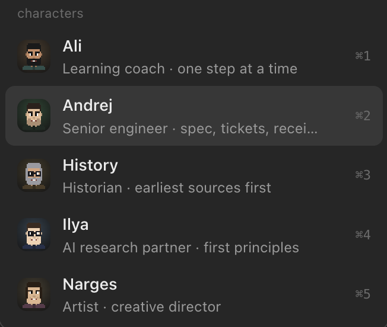

# Character pack

Five ready-made characters for Pi Desktop, each a complete harness: a `pi-<id>` script, a character file (face,
accent, greeting, suggestions, finish line, persona), its own skills, and a workspace with rules. They run on a
default Pi install with whatever provider and model you already use, in Pi Desktop and in the terminal.



| id | Name | Role | Skills |
|---|---|---|---|
| `engineer` | Andrej | Senior engineer: grill → spec → tickets → parallel → validate | `engineer` |
| `ai` | Ilya | AI research partner: papers, models, first principles | `ai-research`, `research` |
| `history` | History | Historian: earliest sources first, source criticism | `history-method`, `research-lanes`, `findings-list` |
| `learning` | Ali | Learning coach: one step at a time, persistent topic workspaces | `learn` |
| `image` | Narges | Artist / creative director: images with a refinement loop | `image`, `image-refinement-loop` |

Each folder's `README.md` covers who the character is, its skills, its workspace and optional tools.

## Install

```bash
scripts/install-pack.sh all              # or some of them: scripts/install-pack.sh ai learning
```

For each character this writes:

- `<harnessDir>/pi-<id>`: the harness (`harnessDir` from `config.json`, default `~/bin`; or `--bin DIR`). It points
  at this Pi Desktop folder, so don't move the folder afterwards (or re-run the installer with `--force`).
- `characters/<id>.json`: the character file. Edit it freely.
- `characters/<id>/`: the pixel face (needs Python 3 + Pillow; without it the app shows a letter avatar, and
  `pip3 install pillow && npm run faces` fixes it later).

Existing files are never overwritten unless you pass `--force`. Restart Pi Desktop (or press Reload on its welcome
screen) to see the characters.
In a terminal, run `pi-ai`, `pi-history`, ... (with `~/bin` on your `PATH`).

## Uninstall

```bash
scripts/install-pack.sh all --uninstall
```

Removes the harness scripts and character files that still match the pack (add `--force` to remove changed ones
too), and the faces drawn from them. Workspaces and everything the characters wrote are left alone.

## Workspaces

Every character except Andrej starts in its own folder, `~/pi-studio/<id>/`, created on first run. The pack's
`workspace/AGENTS.md` is copied there once (never overwritten), so the rules are yours to edit. Each folder keeps
its own chat list in Pi Desktop. Andrej works in whatever repo you start him from; see `engineer/README.md`.

Set `PI_STUDIO=/some/dir` to keep workspaces elsewhere in the terminal. Pi Desktop reads the folder from the script's
literal `cd "$HOME/pi-studio/<id>"` line, so also add `"cwd"` (and, for Ali, `"learningRoot"`) to the character file.

## Requirements

- Pi Desktop and a working `pi` (any provider, any model; nothing is pinned. To pin one, add
  `--model provider/id` to the `exec pi` line of the installed script).
- Optional: Python 3 + Pillow for faces; a web search / fetch extension or MCP server for the research characters;
  an image generation tool for Narges; `ffmpeg` for Narges's overlay checks.

## How the harnesses load

Each script runs `pi --no-skills --skill <pack>/skills/<name> ...`: only the pack's skills, while your own
extensions (providers, web tools) keep loading. It adds the terminal face (`extensions/pixel-coach`) when present,
which also gives the character its name and persona (the `identity` field) on the first turn.

## Credits

- Characters, personas, quotes and skills: written for Pi Desktop. The characters are fictional; every quote is an
  original line attributed to the character itself.
- Ali's `MISSION-FORMAT.md`, `RESOURCES-FORMAT.md`, `LEARNING-RECORD-FORMAT.md` and `GLOSSARY-FORMAT.md` derive from
  the `teach` skill in [mattpocock/skills](https://github.com/mattpocock/skills) (MIT; see
  `learning/skills/learn/LICENSE-teach.md`).
